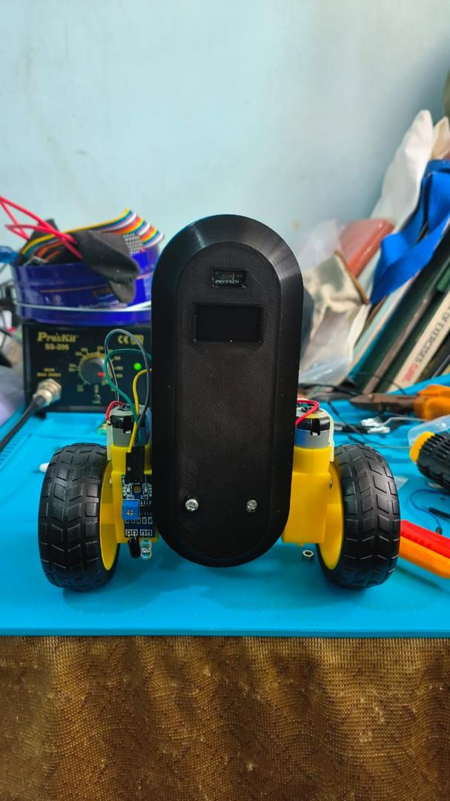
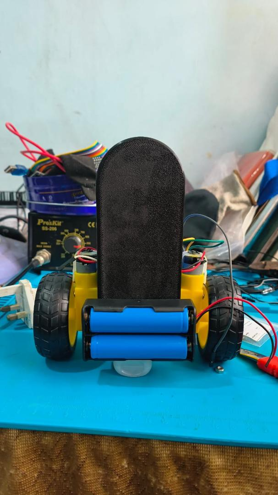
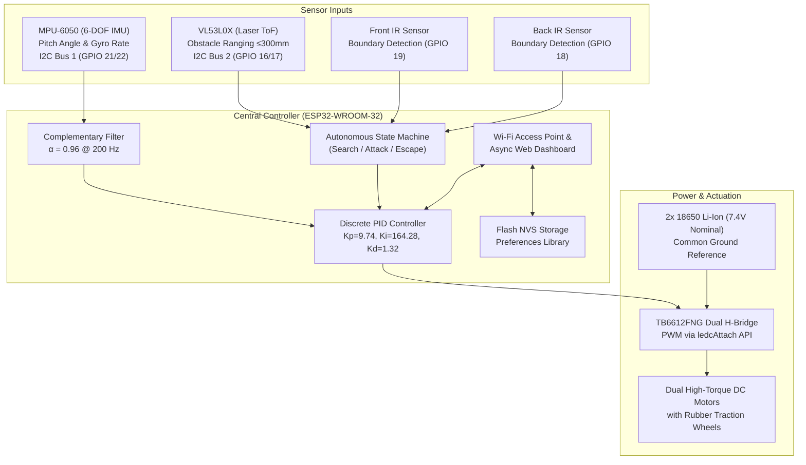
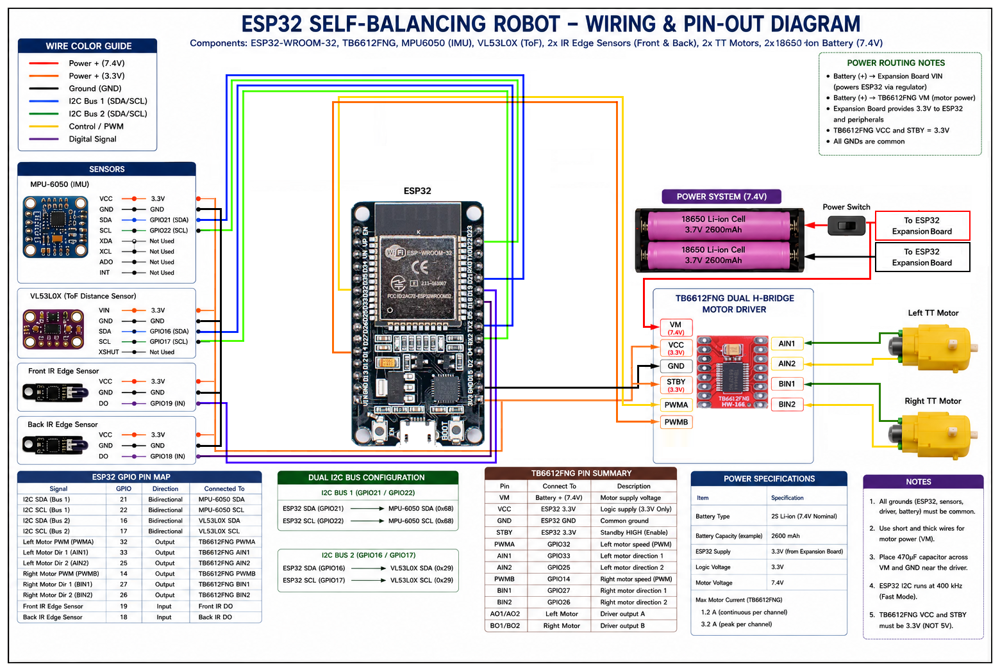
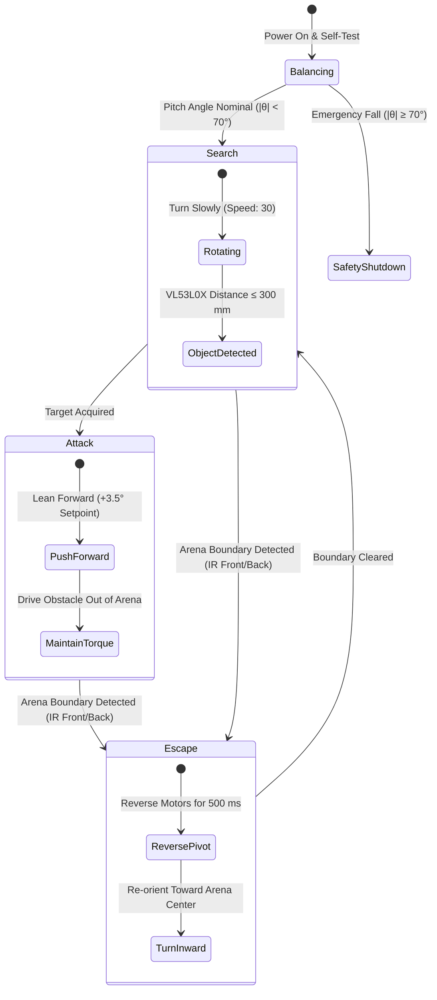
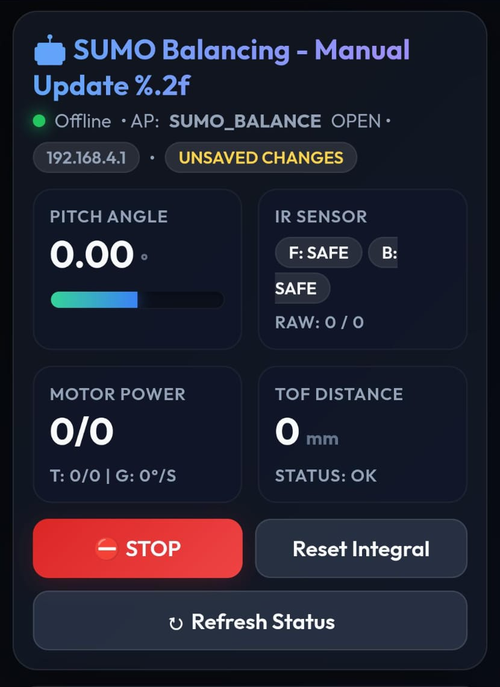

# 🤖 M4T-CH4: Autonomous Self-Balancing Robot

[](https://www.espressif.com/)
[](https://www.arduino.cc/)
[](https://www.freertos.org/)
[]()
[]()

> Developed for the **UniMAP Balancing Robot Tournament 2026** under course **NMT22104: Data Acquisition Technology and Analysis II**, Faculty of Electronic Engineering Technology, Universiti Malaysia Perlis (UniMAP).

---

## 📌 Project Overview

**M4T-CH4** is a high-performance, two-wheeled autonomous inverted pendulum robot. The core technical challenge demands overcoming the inherent dynamic instability of an inverted pendulum while executing a high-torque mechanical objective: **identifying, pursuing, and entirely pushing five distinct obstacles out of a 1-meter radius circular tournament arena** within strict time limits without crossing perimeter boundaries.

### Key Highlights
- **Real-Time Deterministic Control:** Dual-core FreeRTOS architecture running a high-speed 200 Hz (5 ms loop period) complementary filter and PID stabilization loop on one core, while serving an asynchronous Wi-Fi Web Dashboard on the secondary core.
- **Sensor Fusion & Multi-Bus Sensing:** Dual I²C communication bus design isolating the 6-DOF MPU-6050 Inertial Measurement Unit (IMU) and the VL53L0X Time-of-Flight (ToF) laser distance sensor.
- **Autonomous Navigation State Machine:** Fully autonomous behavior switching between Search, High-Thrust Attack (dynamic tilt offset of +3.5°), and Perimeter Escape routines using dual ground IR sensors.
- **Over-The-Air (OTA) Web Telemetry & Dynamic Tuning:** Embedded Wi-Fi Access Point and Web Server (`192.168.4.1`) allowing live parameter calibration (Kp, Ki, Kd, setpoint trim, motor deadband) stored persistently in non-volatile flash storage (`Preferences`).

<div align="center">
  <table>
    <tr>
      <th align="center">Front Chassis & Sensing</th>
      <th align="center">Rear Power & Motor Driver</th>
    </tr>
    <tr>
      <td align="center"></td>
      <td align="center"></td>
    </tr>
  </table>
  <p><em>Figure 1: Physical Prototype Assembly — Front (MPU-6050 & VL53L0X ToF) and Rear (Dual 18650 Li-ion & TB6612FNG Driver)</em></p>
</div>

---

## 🏗️ System Architecture

<div align="center">

<details>
<summary align="center"><b>📐 Click to expand System Architecture Diagram</b></summary>

<br/>



</details>

</div>

<div align="center">
  
  <p><em>Figure 2: Complete Electronic Circuit Schematic & Dual I²C Bus Architecture</em></p>
</div>

---

## ⚙️ Pinout & Hardware Specification

| Subsystem | Component | Pin / Channel | Description |
|---|---|---|---|
| **MCU** | ESP32-WROOM-32 | 30-Pin Module | Dual-core Tensilica Xtensa 32-bit LX6 @ 240 MHz |
| **IMU (Bus 1)** | MPU-6050 | GPIO 21 (SDA), GPIO 22 (SCL) | Accelerometer + Gyroscope orientation tracking |
| **ToF (Bus 2)** | VL53L0X | GPIO 16 (SDA), GPIO 17 (SCL) | Millimeter-accurate obstacle distance ranging |
| **Edge Sensors** | TCRT5000 IR Modules | GPIO 19 (Front), GPIO 18 (Back) | Active-low boundary line edge reflection sensors |
| **Motor Driver** | TB6612FNG | GPIO 32 (PWMA), GPIO 14 (PWMB) | High-efficiency MOSFET dual H-bridge |
| **Direction Logic**| Motor A (Left) | GPIO 33 (AIN1), GPIO 25 (AIN2) | Forward/Reverse logic gates |
| **Direction Logic**| Motor B (Right) | GPIO 27 (BIN1), GPIO 26 (BIN2) | Forward/Reverse logic gates |
| **Power Supply** | 2S Li-ion Battery | 7.4V (VIN / VM) | Dual 18650 cells for motor peak torque supply |

---

## 🧠 Control Algorithms & State Logic

### 1. Complementary Filter Angle Estimation
To eliminate accelerometer high-frequency vibration noise and gyroscope long-term drift:
$$\theta_{\text{pitch}} = 0.96 \times (\theta_{\text{pitch}} + \omega_{\text{gyro}} \cdot \Delta t) + 0.04 \times \theta_{\text{accel}}$$
Evaluated at a deterministic 200 Hz update frequency ($\Delta t = 5\text{ ms}$).

### 2. Tuned Discrete PID Controller
- **Proportional Gain ($K_p = 9.74$):** Delivers immediate corrective torque proportional to tilt error.
- **Integral Gain ($K_i = 164.28$):** Eliminates steady-state error caused by mechanical center-of-gravity imbalance.
- **Derivative Gain ($K_d = 1.32$):** Damps oscillation velocity and counteracts sudden tipping momentum.
- **Dynamic Setpoint Offset:** Programmed baseline setpoint of $-4.71^\circ$ counteracts rear battery mass bias. During obstacle pushing, the setpoint dynamically shifts to $+3.5^\circ$ forward lean to deliver maximum pushing force.
- **Deadband Compensation:** Minimum motor threshold (`motorDeadband = 44.0`) overcomes gearbox friction.

### 3. Finite State Machine (FSM)

<div align="center">

<details>
<summary align="center"><b>🔄 Click to expand FSM State Machine Diagram</b></summary>

<br/>



</details>

</div>

---

## 🌐 Embedded Web Dashboard

The ESP32 broadcasts a private Wi-Fi network with an interactive web UI served from flash memory:
- **Live Diagnostics:** Real-time stream of current pitch, gyro rate, obstacle distance, and active FSM state.
- **Real-Time PID Calibration:** Sliders for Kp, Ki, Kd, setpoint, trim angle, max speed, deadband, and acceleration rate.
- **Flash Persistence:** One-click save writes calibration values to ESP32 NVS using the `Preferences` API, retaining optimal parameters across power cycles.

<div align="center">
  
  <p><em>Figure 3: Live Wi-Fi Telemetry & Dynamic PID Calibration Dashboard (192.168.4.1)</em></p>
</div>

---

## 📁 Repository Structure

```
ESP32_SelfBalancingRobot/
├── assets/                            # High-res hardware photos, schematics & dashboard UI
├── firmware/
│   └── SelfBalancingRobot/
│       └── SelfBalancingRobot.ino     # Complete firmware (PID, FSM, Web Dashboard)
└── README.md                          # Repository documentation
```

---

## 🚀 Getting Started

### Prerequisites

1. **Development Environment:**
   - **Arduino IDE 2.x** (or **VS Code with PlatformIO**).

2. **ESP32 Board Package:**
   - In Arduino IDE, go to **File > Preferences** and add the ESP32 board URL to *Additional Boards Manager URLs*:
     ```text
     https://raw.githubusercontent.com/espressif/arduino-esp32/gh-pages/package_esp32_index.json
     ```
   - Go to **Tools > Board > Boards Manager**, search for **esp32** by *Espressif Systems*, and click **Install**.
   - *Compatibility:* The codebase includes automatic version checks (`#ifdef USE_LEDC_V3`) supporting both ESP32 Core **v2.x** (`ledcSetup`) and **v3.x** (`ledcAttach`).

3. **Required Arduino Libraries:**
   - Open **Tools > Manage Libraries...** (or `Ctrl+Shift+I`) and install:
     - **Adafruit MPU6050** by *Adafruit* (Click *"Install All"* to include dependencies: `Adafruit Unified Sensor` and `Adafruit BusIO`).
     - **Adafruit_VL53L0X** by *Adafruit*.
   - *(Note: `Wire`, `WiFi`, `WebServer`, and `Preferences` are built directly into the ESP32 core package and do not require external installation).*

---

### Flashing the Firmware

1. **Open the Sketch:**
   - Launch Arduino IDE and open `firmware/SelfBalancingRobot/SelfBalancingRobot.ino`.
2. **Select Board & Port:**
   - **Board:** Select **Tools > Board > ESP32 Arduino > ESP32 Dev Module**.
   - **Port:** Select your active ESP32 COM port (e.g., `COM3`, `COM4`).
3. **Configure Board Settings:**
   - **CPU Frequency:** `240MHz (WiFi/BT)`
   - **Flash Frequency:** `80MHz`
   - **Flash Mode:** `QIO` (or `DIO`)
   - **Upload Speed:** `921600` (or `115200` if upload fails)
   - **Partition Scheme:** `Default 4MB with spiffs (1.2MB APP/1.5MB SPIFFS)`
   - **Core Debug Level:** `None`
4. **Compile & Upload:**
   - Ensure the robot battery power switch is **OFF** to prevent unexpected motor spin during programming.
   - Connect the ESP32 to your PC via micro-USB.
   - Click the **Upload** button (`Ctrl+U`).

---

### Operating & Tuning

1. **Initial Verification via Serial Monitor:**
   - Open **Tools > Serial Monitor** and set the baud rate to **115200 baud**.
   - You should see the boot diagnostics:
     ```text
     --- Sumo Balancing WEB %.2f ALL INPUT 2 DECIMAL ---
     MPU OK
     TOF OK
     Loaded NVS: Kp:9.74 Ki:164.28 Kd:1.32 SP:-4.71 DB:44.00
     AP OPEN SUMO_BALANCE IP: 192.168.4.1
     ```

2. **Connecting to the Wi-Fi Dashboard:**
   - Disconnect the USB cable and switch **ON** the 7.4V battery pack.
   - On your smartphone or laptop, search for available Wi-Fi networks and connect to:
     - **SSID:** `SUMO_BALANCE`
     - **Password:** *None (Open AP)*
   - Open any web browser and navigate to:
     ```text
     http://192.168.4.1
     ```

3. **Live Telemetry & Calibration:**
   - **Live Telemetry:** View real-time pitch tilt bar, angle readout, and wheel motor PWM speeds.
   - **Dynamic PID Sliders:** Adjust $K_p$, $K_i$, $K_d$, setpoint trim angle, motor deadband, acceleration step, and max speed on the fly.
   - **Flash Persistence:** Click **Save to Flash** to write calibrated parameters to ESP32 non-volatile storage (`Preferences`), retaining optimal tuning across reboots.

4. **Direct Serial CLI Commands (Optional):**
   - When connected via USB Serial at **115200 baud**, parameters can also be calibrated dynamically via command line:
     - `kp:9.74` — Set Proportional Gain
     - `ki:164.28` — Set Integral Gain
     - `kd:1.32` — Set Derivative Gain
     - `sp:-4.71` — Set Balance Angle Setpoint
     - `trim:0.00` — Set Angle Trim Offset
     - `db:44.00` — Set Motor Deadband Threshold
     - `max:200.00` — Set Maximum Motor Speed Limit

---

## 👥 Project Contributors

Developed as part of **NMT22104: Data Acquisition Technology & Analysis II** within the **Industrial Electronic Automation Programme**, Faculty of Electronic Engineering Technology, **Universiti Malaysia Perlis (UniMAP)**:

| Contributor | Matric ID | Focus Area |
|---|---|---|
| **Nik Mohamad Azizi Nik Yahya** | `241503239` | Sensor Integration, Hardware Assembly & Firmware Architecture|
| **Akmal Haikal Mohd Muzammer** | `241501824` | PID Control, Hardware Design & Testing |
| **Afifah Nadhirah Selbini** | `241501822` | Documentation |

**Project Supervisor:** Mr. Suhaizal bin Abu Hassan  
*Faculty of Electronic Engineering Technology, Universiti Malaysia Perlis*

